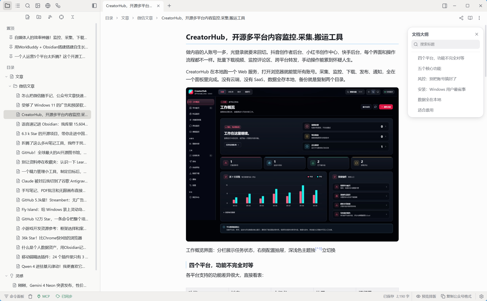
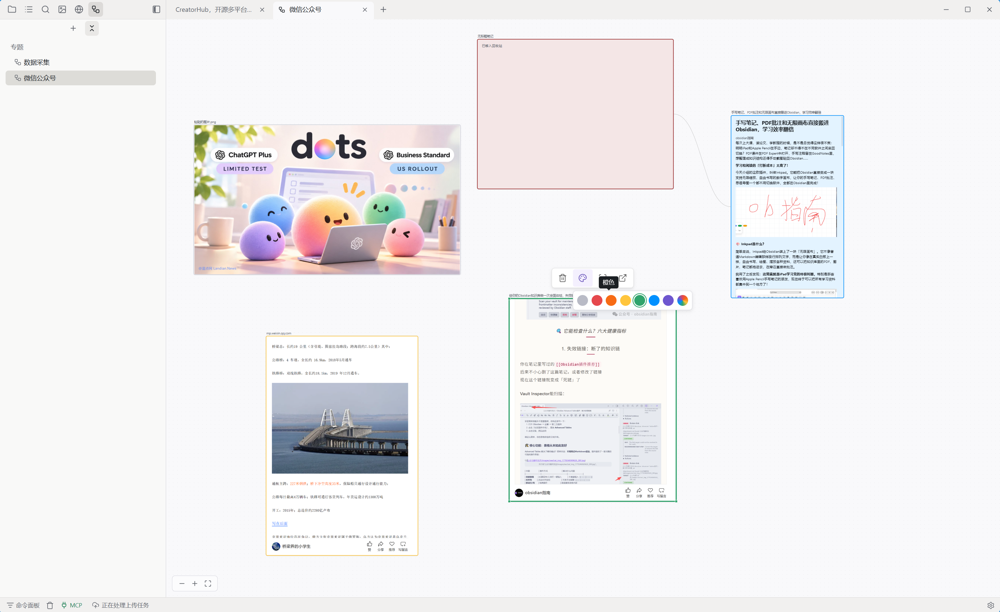
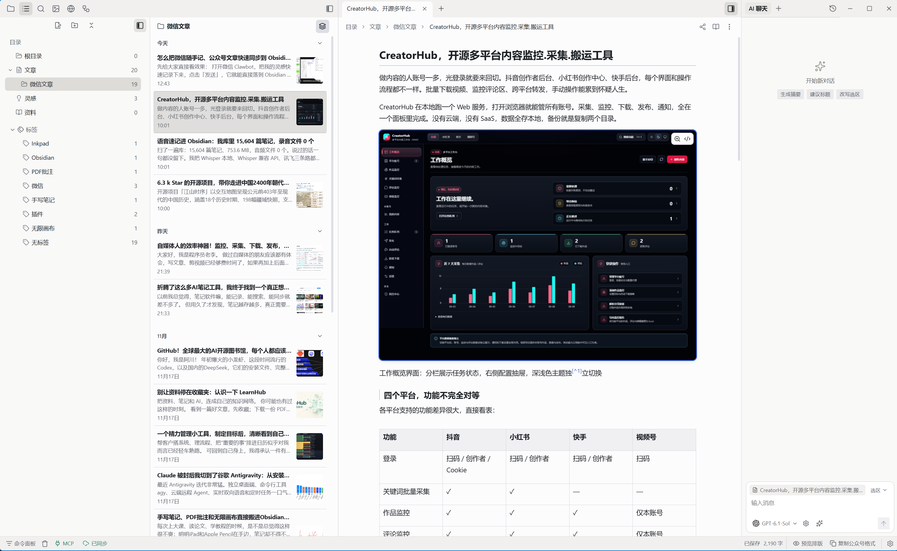
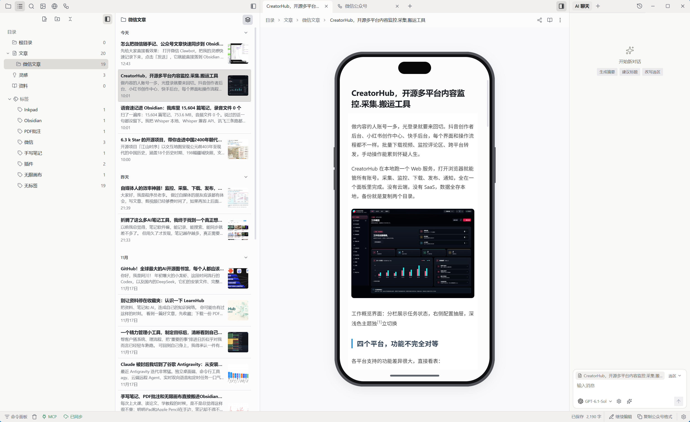
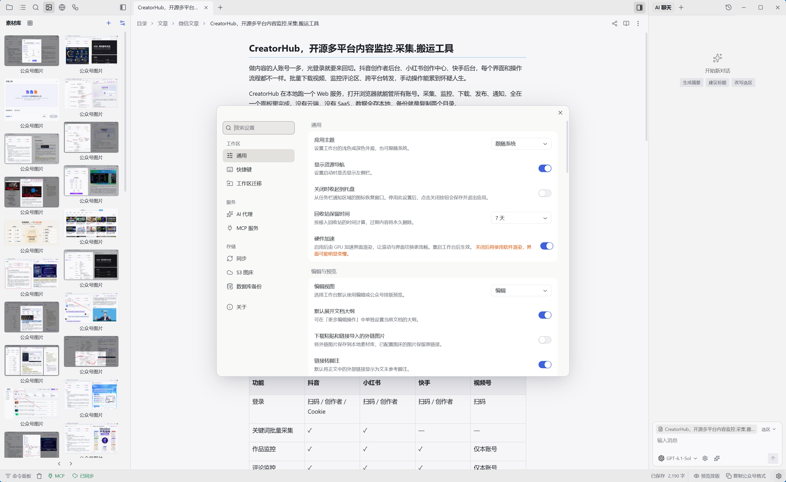

  

# 微信创作工作台

**从一条灵感，到一篇可以复制到公众号的文章。**

收集公众号文章、网页和 GitHub 项目，把资料放进选题画布，接着写作、调用 AI、预览排版。微信创作工作台把这些步骤放进一个本地桌面应用，让你围绕文章持续创作。

[开始使用](#开始使用) / [安装与配置](docs/getting-started.md) / [版本发布](https://github.com/lifei6671/wechat-creator-workbench/releases) / [反馈问题](https://github.com/lifei6671/wechat-creator-workbench/issues)

## 为持续写公众号的人准备

写一篇文章，往往从收集资料就开始了。看到一篇好文章先收藏，找到一个开源项目再记下来，写稿时还要翻浏览器、找截图、整理提纲，最后换个工具处理公众号排版。

微信创作工作台把资料、选题、正文和排版连在一起。今天收集的内容，可以成为下一篇文章的素材；围绕选题整理过的画布，也可以留着继续研究。

## 你可以用它做什么

### 把看到的好内容留下来

粘贴公开公众号文章、普通网页或 GitHub 仓库链接，导入正文并保留来源。已有 Markdown 文章也能导入，使用 Obsidian Web Clipper 时可以直接粘贴剪藏内容。

用文件夹、标签和全文搜索管理资料，写到一半也能找回之前收集的内容。

### 在选题画布上整理思路

把参考文章、网页、截图和文本卡片放到同一张画布上，自由排列、连线和批注。适合做开源项目选题、教程资料整理，或把零散灵感组织成文章脉络。

文章卡片引用内容库中的原文，同一篇资料可以放进不同选题，集中维护。

### 从提纲写到正文

用可视化编辑器写作，以 Markdown 保存正文。标题大纲、列表、表格、代码块、公式和 Mermaid 图表都能放进文章，多标签页方便对照资料与稿件。

自动保存、历史版本和回收站帮助你保留写作过程；需要专注时，可以收起辅助面板。

### 接入你自己的 AI

请 AI 总结资料、生成标题、改写选区，或围绕当前文章继续讨论。建议可以先检查，再决定是否写入正文。

支持 Codex CLI、Claude Code、本地 Ollama / LM Studio，以及自定义模型接口。AI 按需启用，启用后会将本次请求所需的内容交给选定的模型或代理。

### 预览排版，复制到公众号

选择公众号主题，查看手机尺寸下的排版效果，再复制公众号格式，到公众号后台粘贴、检查并发布。也可以导出 Markdown 或排版 HTML。

支持素材库和 S3 兼容图床。配置图床后可使用图片公开链接；未配置时，可以按正文顺序逐张处理图片。

### 按自己的方式保存和同步

文稿和素材默认保存在本机，支持离线写作。多台电脑之间可以接入自托管同步服务，部署在 Cloudflare、VPS 或 NAS，遇到内容冲突时保留选择和处理入口。

工作区迁移包用于转移数据库、素材和界面设置；S3 数据库快照用于备份和恢复数据库，图片由本地文件或图床提供。

查看素材库与工作区设置

## 一次完整的创作流程

1. **收集资料**：导入文章、网页或 GitHub README，归入文件夹并打上标签。
2. **组织选题**：把相关资料加入专题画布，放上截图和自己的想法。
3. **写成文章**：对照资料写正文，需要时让 AI 帮忙梳理和润色。
4. **完成排版**：选主题、看预览，复制到公众号后台检查并发布。

工作台也提供本机 MCP 服务，可以让 Codex CLI、Claude Code 等客户端按你设置的权限查阅或编辑内容。[查看配置方法](docs/getting-started.md#本机-mcp)

## 开始使用

项目仍在开发中，可从 [Releases](https://github.com/lifei6671/wechat-creator-workbench/releases) 下载预览版安装包，也可以按照[安装与配置指南](docs/getting-started.md)从源码运行。

桌面客户端面向 Windows 和 macOS。自托管同步、图床、AI 和数据库备份均可按需配置；本地写作可以先独立使用。

| 我想做什么 | 去哪里 |
| --- | --- |
| 在本机运行、构建或配置 AI / MCP | [安装与配置](docs/getting-started.md) |
| 搭建多设备同步服务 | [同步服务部署](apps/sync-server/README.md) |
| 了解更新签名和发行流程 | [发行指南](docs/release-guide.md) |
| 查看技术方案、设计规范与研发文档 | [文档目录](docs/README.md) |
| 报告问题或提出需求 | [GitHub Issues](https://github.com/lifei6671/wechat-creator-workbench/issues) |

## 开源与致谢

项目采用 [GPL-3.0](LICENSE) 许可证。感谢 Tauri、React、Milkdown、Radix UI、React Flow、assistant-ui 等开源项目，以及提供公众号排版基础的 [Plainly](https://github.com/lifei6671/plainly)。第三方许可和来源见 [NOTICE](NOTICE.md)。
