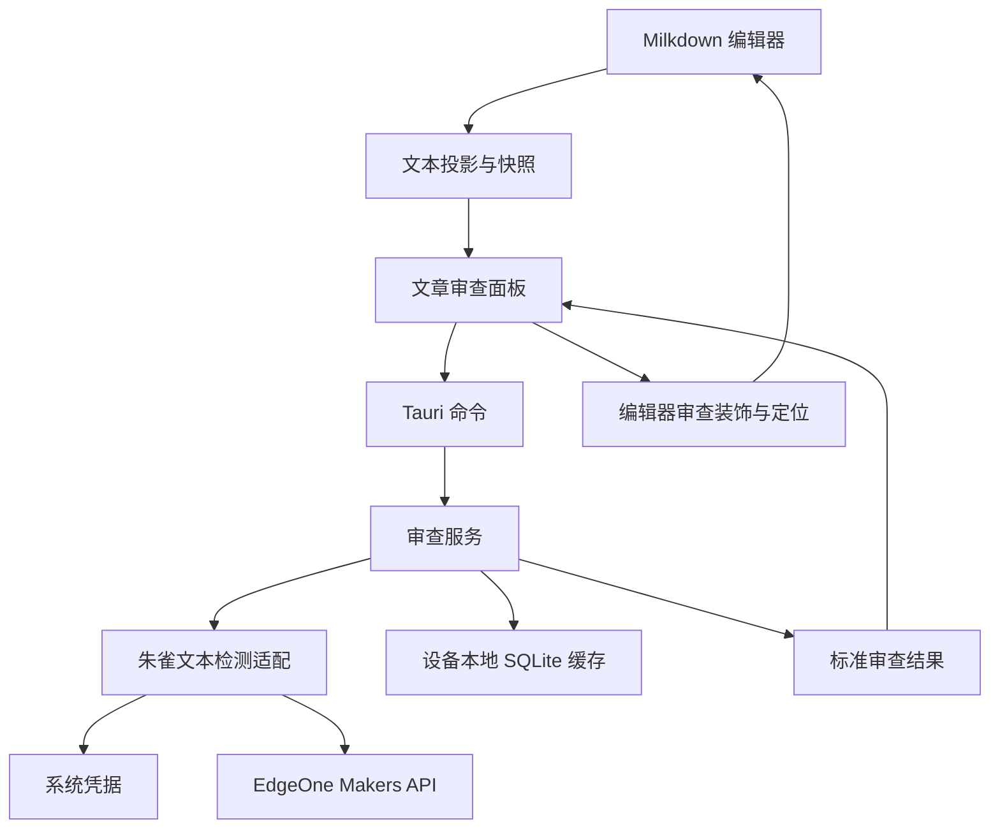

# 文章质量审查工作台技术方案

日期：2026-11-26  
范围：微信创作工作台桌面端，首期朱雀文本检测

## 1. 目标与交付范围

在文章编辑流程中提供统一的审查入口，将检测结果转化为可定位、可复核的文档诊断。审查独立于写作助手和公众号排版预览，不修改原始 Markdown，不阻断保存、复制、发布或同步。

首期完成以下闭环：配置用户自有朱雀 API Key → 主动检测当前文章或选区 → 展示分类占比与分段结果 → 点击定位并高亮 → 人工修改 → 结果失效并主动复检。相同检测输入可复用近期缓存。

后续按真实需求增加拼写与标点、表达清晰度、链接有效性、事实与来源核查、发布规范检查，以及通过现有 AI 助手生成可审核的修改建议。首期只实现一种检查器，不建立动态插件加载、通用任务队列、规则 DSL 或新的 Agent 执行框架。

AI 文本检测属于统计推断，不能证明作者身份，也不代表微信平台的审核结果。界面显示各检查器的独立结果，不构造混合质量总分，不以检测分数作为发布门槛。表达修改面向准确性、可读性和作者实际意图。

## 2. 现有源码与集成边界

以 2026-11-26 Windows 本地工作区读取结果为基线。实施前以最新源码为准核实以下入口。

| 现有文件 | 集成方式 |
| --- | --- |
| apps/desktop/src/workspace/RightSidebar.tsx | RightSidebarMode 增加 review；工具栏延续现有键盘导航、禁用和反馈状态 |
| apps/desktop/src/workspace/Document.tsx | 接入当前 MarkdownEditorHandle，检测选区及正文；定位时切换到文章编辑模式 |
| apps/desktop/src/workspace/DesktopShell.tsx | 核实右栏状态实际所有者、文章切换与编辑器生命周期，接入审查状态 |
| apps/desktop/src/workspace/Settings.tsx | 接入审查服务配置，复用既有设置表单及错误反馈组件 |
| apps/desktop/src/desktop.ts | 统一 invoke 类型及调用包装 |
| packages/editor-react/index.tsx | 扩展 MarkdownEditorHandle；沿用现有 $prose、PluginKey、DecorationSet 实现方式 |
| packages/editor-react/search-location.ts | 评估复用已有位置计算逻辑；保持搜索与审查装饰彼此独立 |
| packages/shared-types | 仅在确有跨包共享需求时新增审查 DTO |
| src-tauri/src/secrets.rs | 使用 workspace 隔离的系统凭据 |
| src-tauri/src/ai/settings.rs | 参考设置和凭据管理；现有 ModelConfig 会补 /chat/completions，不属于分类接口契约 |
| src-tauri/src/db.rs、main.rs | 复用 Workspace、AppError、数据库访问与 Tauri 注册约定 |

遵循 AGENTS.md 与 docs/ui-design-guidelines.md。用户可见界面先提供原型供确认，再合并界面改动。纯服务与契约测试可先实施。

## 3. 总体设计



前端负责获取实时编辑器内容、位置映射、会话状态和显示；Rust 负责鉴权、远程请求、解析与校验、缓存、用量。检查器以稳定的 checkerId 区分，首期只有 zhuque_text，使用枚举或直接 match 分发即可；第二个检查器落地后再判断是否提取 trait。统一的是诊断模型和操作流程，而非把不同检查能力强行包装成同一种模型调用。

建议增量文件（按实际模块组织调整）：

- src-tauri/src/review.rs：命令与服务编排。
- src-tauri/src/review/zhuque.rs：朱雀请求、响应与位置归一化。
- src-tauri/src/review/settings.rs：配置及凭据操作。
- src-tauri/src/review/cache.rs：本地缓存和用量账本。
- packages/editor-react/review-projection.ts：纯文本投影与位置映射。
- packages/editor-react/review-decoration.ts：装饰插件。
- apps/desktop/src/workspace/ReviewPanel.tsx、ReviewSettings.tsx：面板与设置。
- apps/desktop/src/workspace/review-session.ts：当前文章的审查状态及请求竞争控制（复杂度不足时与面板合并）。

编辑器包不依赖具体厂商或桌面 IPC；厂商响应 DTO 不进入 React 组件。审查配置和缓存不加入内容同步实体。

## 4. 朱雀接入契约

依据腾讯云《使用朱雀模型》（2026-11-12 更新）：
https://cloud.tencent.com/document/product/1552/137539

首期选用 Makers 内置模型 @makers/zhuque-text，固定 HTTPS POST 地址：
https://ai-gateway.edgeone.link/v1/providers/zhuque-text/classify

用户自行在 EdgeOne Makers 控制台创建 API Key。请求使用 Authorization: Bearer <API_KEY> 和 application/json。发送 text 与 is_merge: false，获得细粒度分段结果。

字段处理：

| 字段 | 内部处理 |
| --- | --- |
| status / msg | 校验业务成功状态，失败归为明确错误 |
| labels_ratio | 保留 0（人工）、1（AI）、2（疑似 AI）的原始比例 |
| ratio_confidence / softmax_confidence | 分别保留为厂商整体指标，不等同于真实创作概率 |
| segment_labels | 解析 text、label、conf、order、position，用于诊断 |
| makers_models_usage.total_tokens | 计入本地观测到的额度消耗 |
| usage.total_tokens | 仅为模型用量参考，不累计到 Makers 额度 |

官方给出的 Makers 免费额度为每月 50 万 token，与平台其他内置模型共享。客户端只掌握自身成功返回的扣减数据，无法据此推断账户真实余额。套餐、适用条款和额度以控制台为准。

Makers 模型概览：https://cloud.tencent.com/document/product/1552/132760
正式企业版 Model Pro 参考：https://cloud.tencent.com/document/product/1552/135974
Model Pro 是另外的网关和计费契约，提供图像与任务查询能力，首期不接入。发布前核实 Makers 使用条款及适用场景，体验服务仅作为可选辅助能力。

### 4.1 HTTP 与错误

复用 reqwest、serde、现有 AppError。固定域名及路径，不自动跟随重定向，密钥只在 Rust 构造请求时获取。连接超时建议 10 秒，总超时初始 60 秒（均为客户端策略，按联调调整）。异步 Rust 调用，等待网络时不持有数据库锁。单次只提交一个请求；同 workspace、同一缓存键的并发请求合并，或在服务入口统一拒绝重复执行。

HTTP 401/403 提示检查凭据或权限，429 提示稍后重试或核查配额，5xx/超时提示请求结果不确定，其他非 2xx、非法 JSON、status 非 success、关键字段非法均返回可定位错误。具体 Makers 错误码以联调为准。禁止自动重试推理 POST：请求超时不意味着远端没有计费。错误和日志不包含密钥、请求正文、回显正文或原始完整响应。

成功响应校验标签、有限数值、比例区间、非负用量和位置结构。允许额外字段；无法定位的分段保留其摘要与分类，不生成错误高亮。整体字段缺失时不伪造 0 或正常结果；明确区分未知用量和 0 用量。

## 5. 文本投影与位置映射

### 5.1 输入快照

检测源为当前活动文章的实时 ProseMirror 文档，而不是 SQLite 中可能尚未保存的旧 Markdown。正文检测含正文内标题，文章独立的标题属性不纳入首期投影；选区检测使用捕获时的实际选区。按文档顺序遍历可见文本节点，保留普通段落、标题、引用、列表项及链接显示文字；忽略图片、链接 URL、代码块、Mermaid、公式、表格与独立资源节点。行内代码首期保留显示文本，软换行规范为 LF。块之间用固定的双 LF 分隔。检测范围应在界面说明。空文本直接提示，无远程请求。

不对整个 Markdown 做正则清洗，不随意 trim 每段或 Unicode 归一化。若进行空白过滤，须同步记录偏移。投影仅在主动检测、缓存查询、或需要重建当前结果时计算，不在每次按键进行全文序列化。

```ts
type ReviewProjection = {
  text: string;
  version: number; // 提取规则版本
  runs: {
    textFrom: number; textTo: number; // UTF-16, 左闭右开
    pmFrom: number; pmTo: number;
  }[];
};
type ReviewSnapshot = {
  workspaceId: string;
  entryId: string;
  editorSessionId: string;
  docGeneration: number;
  scope: "document" | "selection";
  projection: ReviewProjection;
};
```

runs 保存连续文本片段而非每字符对象；人工插入的分隔符不映射到文档位置。跨多个文本节点的诊断区间拆成多个合法装饰范围。对部分选中、嵌套引用/列表、mark 分裂节点、hard break、内联 atom、中文及 emoji 编写测试。

### 5.2 偏移契约确认

Makers 文档示例中的 position 是数组，但未充分明确非 ASCII 字符的单位和端点语义。开发者须先用自编测试文本真实调用，覆盖中文、ASCII、非 BMP emoji、组合字符、重复段落、换行及多段落。比较返回 segment.text 与输入切片，确定 UTF-8 字节、Unicode 标量或 UTF-16 单元及开闭区间。实现明确的转换函数，将外部区间归一为 UTF-16 左闭右开；转换后校验切片及合法字符边界。

未验证契约前不发布精确高亮。若单个分段位置缺失或不一致，仅在其文本于限定范围唯一匹配时允许定位；重复文本无法唯一定位时标记该条“无法定位”。不使用 order 直接对应 Markdown 段落序号，不猜测偏移。

真实最小、最大输入长度、分段数量及超限错误也在此阶段测量。首期采用验证过的长度上限，超限提示用户选择部分正文；不自行拼接多次检测的整体占比。上限未知时不可把经验值宣称为厂商限制。

### 5.3 装饰与导航

在 editor-react 中新增独立 PluginKey<DecorationSet>，通过事务 meta 更新结果，事务不进入撤销历史（addToHistory: false），不改变文档。按检查类型和结果标签设置独立 CSS 类，支持浅色/深色及可访问的非颜色区分。清除审查装饰不影响搜索高亮、选区和现有 AI 建议。

点击结果通过 EditorView/现有编辑器导航接口滚动至第一段合法范围；必要时切到编辑视图，等待同一 entryId 编辑器就绪再定位。禁止直接操作正文 DOM 或把标记写进 Markdown。导出、复制、保存、历史和同步内容不包含装饰。

## 6. 审查结果与命令契约

以下为概念类型，实施时按仓库 camelCase 序列化约定组织 Rust 与 TS。

```ts
type ReviewFinding = {
  id: string;
  checkerId: string;
  category: string; // 首期 ai_generated / ai_suspected
  level: "info" | "warning"; // 审阅优先级，不代表真假
  range: { from: number; to: number } | null; // 投影 UTF-16
  message: string;
  confidence?: number; // 厂商提供时显示
};
type ZhuqueSummary = {
  humanRatio: number;
  aiRatio: number;
  suspectedRatio: number;
  ratioConfidence: number;
  softmaxConfidence: number;
};
type ReviewResult = {
  checkerId: "zhuque_text";
  contentHash: string;
  projectionVersion: number;
  checkedAt: number;
  cacheHit: boolean;
  chargedTokens: number | null; // 当前请求实际观察到的扣减；缓存命中为 0
  summary: ZhuqueSummary;
  findings: ReviewFinding[];
};
```

首期仅将 label 1 和 2 转为待复核发现；人工类只参与汇总。分段置信度使用厂商定义，未确认其统计语义前不自创阈值。全篇与选区的结果分开呈现，不把选区占比当全文占比。摘要保留三类比例，UI 小数舍入不用于判定。

| Tauri 命令 | 输入及职责 |
| --- | --- |
| review_settings | 返回启用状态、hasKey 等非敏感配置 |
| review_save_settings | 保存启用状态及可选密钥更新；省略密钥表示保持，显式清除按既有凭据契约 |
| review_test_connection | 使用固定的非私人测试文本验证真实模型接口及响应；提示会消耗额度 |
| review_check | checkerId、text、projectionVersion、force；服务端计算哈希，查缓存或调用远端，返回标准结果 |
| review_usage | 返回当前设备、本月已观测到的 Makers 扣减与缓存统计（需要时由设置页读取） |

review_check 仅接受本地可信应用窗口按现有 Tauri 权限模式调用，不新增 HTTP MCP 对外写入/检测工具，不允许远程网页调用。命令校验启用状态、凭据、输入大小与 checkerId；凭据不返回 WebView。请求 scope、entryId、editorSessionId、docGeneration 由前端会话捕获和核对，不将文档位置绑定到缓存。

## 7. 生命周期与并发

每个活动文章审查会话拥有状态 idle / running / ready / stale / error；关闭面板或切换文档可丢弃 UI 结果，不等价于远端取消。

1. 点击检测时捕获实时快照和唯一 requestId，当前文章相同检测按钮进入等待状态。
2. Rust 完成请求并保存有效结果；前端返回时同时核对 workspace、entry、editorSession、docGeneration、requestId。
3. 匹配才展示结果和装饰；不匹配则不得写入当前编辑器或覆盖新请求。成功结果仍可进入对应内容哈希缓存。
4. 正文 docChanged（含 AI 应用、撤销、同步替换）后，清空现有装饰，将面板结果标记过期；选择变化本身不使已捕获选区结果失效，但新选区检测必须重新获取快照。
5. 复检时重新投影；若正文投影未变（例如仅修改加粗），服务端缓存可命中，并基于新投影重新建立装饰。
6. 关闭编辑器或工作区更换时释放会话和装饰；旧请求不得将结果或用量写入新的工作区。服务端应捕获请求对应的 workspace 及本地存储身份。

首期采取保守的整份结果失效策略，不做逐段增量重检、不对新内容沿用旧评分、不在输入时自动请求。取消/超时可能已发生远端扣减，界面不承诺免费或退款。

## 8. 数据、缓存与安全

### 8.1 配置及凭据

设置沿用 Workspace 的普通设置存储；API Key 使用 secrets::entry(workspace, "review-zhuque-makers") 的系统 Keyring，参考现有 AI 保存/删除及失败处理。密钥输入框不回填明文，提供已配置状态和删除能力。每台设备独立配置密钥，不把它加入同步、备份或日志。启用设置时说明检测文本将发送给腾讯服务，主动检测才上传选定范围。首次发送前明确告知；连接测试只发送固定无敏感信息的测试文本。配置或密钥变化使运行中旧会话结果失效。

### 8.2 本地缓存

优先使用工作区专属、位于应用本地数据目录的独立派生 SQLite 文件 review-cache.sqlite3（实施时核实 Workspace 实际路径与备份选择范围），避免修改主库 schema、同步触发器及全库备份格式。缓存可重建，不参与备份与内容同步。若项目已有满足此契约的派生数据库，复用其连接管理。

```sql
CREATE TABLE IF NOT EXISTS review_cache (
  cache_key TEXT PRIMARY KEY,
  checker_id TEXT NOT NULL,
  result_json TEXT NOT NULL,
  checked_at INTEGER NOT NULL
);
CREATE TABLE IF NOT EXISTS review_usage (
  month TEXT PRIMARY KEY,
  known_tokens INTEGER NOT NULL DEFAULT 0,
  unknown_calls INTEGER NOT NULL DEFAULT 0,
  successful_calls INTEGER NOT NULL DEFAULT 0
);
```

缓存键使用无歧义序列化后的 checkerId、厂商/模型标识、适配器结果版本、投影版本、is_merge、精确 text 做 SHA-256。缓存只保存标准化结果和文本偏移，不保存原始文章、原始 segment.text、编辑器绝对位置或 API Key。UI 摘要由当前有效快照切片生成。缓存按工作区隔离，不跨 workspace 复用。

建议有效期 30 天，设置页支持清理；访问或写入时清理过期缓存，无需后台调度器。提供主动重新检测（force），明确其会产生额外请求。默认文章检测与选区检测在精确文本相同的情况下可复用推理结果，显示范围由调用侧决定。

只缓存成功且契约有效的结果。远端成功后将缓存与已知用量更新放在一个本地事务；本地持久化失败不得自动重发推理，必要时仍展示内存中有效结果并注明未缓存。成功调用缺失扣减字段时累加 unknown_calls；超时、传输断开等不计为 0 消耗，无法知道真实扣减。连接测试同样计入已知用量。月份口径需与控制台核实；本地统计显式标明是设备观测值。缓存清理不清除用量汇总，历史月份可保留 12 个月。

## 9. 界面设计与操作

右侧栏增加“文章审查”，图标选用现有 Lucide 图标体系，文章编辑状态可用；专题画布和无当前文章时不可用。首期只有一个检查项“AI 文本检测”，将来增加检查器按类别组织。现有公众号设置、AI 助手、内容属性和大纲行为保持原样。

原型结构：

```text
文章审查
  AI 文本检测
  [检测全文]   [检测选区]
  检测范围：正文 / 选区
  人工 60% | AI 20% | 疑似 AI 20%
  [✓] 正文标记
  待复核内容 (2)
    AI 生成      第一个片段…
    疑似 AI      第二个片段…
  检测时间 · 本次扣减
  [重新检测]
```

以上数据为示意。每项结果包含分类文字与当前快照中的短摘要，点击定位；不能定位时仍可查看分类信息。结果过期时隐藏高亮、禁用旧定位，显示“正文已修改，请重新检测”。在设置页提供服务启用、API Key 输入、连接测试、已知用量和缓存清理。未配置时引导进入对应设置；不复制已有设置入口。

保留编辑器可操作性；遵循现有按钮反馈、固定错误区域、键盘导航和减少动态效果规则。按钮根据真实请求状态变化，不用计时器伪造完成。颜色同时配合标签与可读文字，避免大面积背景遮盖正文。应用 Windows 与 macOS 均使用共享逻辑，分别验证 WebView2/WKWebView 的样式、定位、输入法和长文性能。

未来 AI 修改联动：将用户选中的待复核内容及真实写作要求交给已有 AI 助手，复用已有建议/确认/冲突检查机制；不得直接静默覆盖文章。事实核查需要可访问来源和证据，未核实的断言显示待核查而非错误。各检查器各自定义输入范围、结果有效性和指标。

## 10. 实施顺序

### 阶段一：服务契约验证

- 创建个人 Makers Key，使用固定合成样本联调，记录日期、长度、实际用量、响应结构、偏移单位、分段规则及错误行为；记录仅包含非私人合成文本，禁止保存密钥。
- 实现 Rust 适配器、配置与命令注册，补充固定响应 fixture 和本地 mock HTTP 测试，测试不依赖真实云端。
- 核实实际最大输入限制及使用条款；偏移不明确时先提供汇总，不发布不可靠定位。

### 阶段二：审查闭环

- 实现投影、位置映射、会话状态、缓存及用量。
- 先展示 UI 原型供确认，再实现设置、右栏入口、全文/选区检测、结果与导航。
- 与现有保存、编辑器、导出和同步测试联动，完成双平台回归。

### 阶段三：质量审查扩展

- 根据实际用户反馈逐项新增拼写标点、表达和链接检查，优先评估成熟的本地规则与组件。
- 事实核查与 AI 修改建议独立设计来源与文档修改契约，沿用审查结果和导航机制。
- 第二个检查器出现实际共性后，再提取共享接口；不提前建立调度平台。

## 11. 测试与验收

| 场景 | 验收条件 |
| --- | --- |
| HTTP mock：成功、401、403、429、5xx、超时、错误 JSON、业务失败 | 结果与错误正确，超时不自动重发，不泄露密钥或正文 |
| 官方响应字段与额外字段 | DTO 解析正确；未知用量不伪造；0/1/2 标签正确 |
| 中文、emoji、组合字符、重复句子、嵌套列表、链接、表格、代码、选区 | 投影与映射符合契约；无法验证的区间不高亮 |
| 同正文复检、仅排版修改、force、缓存过期 | 命中不请求；force 发起一次新请求；重新定位准确 |
| 编辑中请求返回、切换文章、工作区切换、关闭编辑器、同步覆盖 | 旧响应不覆盖当前会话，旧装饰清除，缓存和用量归属正确 |
| 搜索与审查同时打开、撤销重做、复制公众号 HTML、Markdown 导出 | 审查装饰不污染正文、导出或搜索结果 |
| Keyring 缺失、凭据更新、备份与恢复 | 密钥不进主库、日志、同步及备份；本地缓存不随主库迁移 |
| 1000/5000/20000 汉字与含复杂节点长文 | 记录投影、装饰构建耗时；编辑时无网络请求；与现有长文基线对比无明显交互退化 |
| Windows 和 macOS | 验证定位、输入法、暗色模式、网络错误与键盘交互，记录实测或未测状态 |

运行仓库实际 package.json / Cargo.toml 定义的类型检查、单元和集成测试；可复用 editor-session、save-queue、document、settings、button-interactions、sync 相关测试。测试新文件按现有目录约定放置。真实 API 联调由具备个人 Key 的开发者单独执行，不作为普通 CI 必需依赖。

交付需包含：实际联调契约记录、实现文件、测试结果、跨平台验证情况、缓存和备份边界验证。当前方案基于源码静态阅读与公开文档，未使用真实 Key、未验证网络耗时与偏移规则，具体请求长度与数据保留条款尚需核实。
