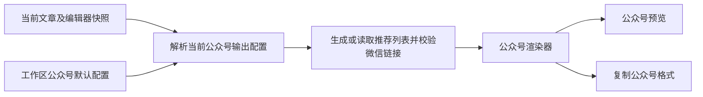

# 公众号输出配置与推荐阅读技术方案

状态：已实现，验收范围见 [验收记录](wechat-publication-validation.md)。首版提供公众号侧栏、可人工调整的推荐阅读，以及配置的跨设备同步和远端备份。同步服务与客户端均使用协议 2。固定头部、尾部在后续阶段实现。

## 1. 功能范围

- 文章右上角新增「公众号」入口，打开配置侧栏，中间显示公众号排版预览。
- 根据当前文章的标题、标签、摘要和正文，为文章自动选择相关的往期已发布文章。默认最多生成 5 条，相关性不足时不补齐。
- 支持人工删除、搜索添加、调整顺序及数量。5 是默认生成数量，手动列表不受 5 条限制。
- 推荐项必须指向文章自己的微信发布链接，不能使用原文来源、其他平台地址或内部文档地址替代。
- 推荐内容只附加到公众号预览与「复制公众号格式」结果，不写入正文，不加入 Markdown 复制、Markdown 导出或普通 HTML 导出。
- 每篇文章的推荐设置和公众号公共配置都写入工作区数据库，进入远端同步及现有快照备份。

首版不增加 AI 请求、向量数据库、多公众号账号管理或空的头尾配置占位区。

## 2. 现有能力与接入边界

以下为编写方案时的当前实现，新增行为以之后章节为准。

| 能力 | 当前实现 | 本次接入方式 |
| --- | --- | --- |
| 公众号预览 | `apps/desktop/src/workspace/Document.tsx` 的 `MarkdownPreview` | 接收与当前内容匹配的推荐列表 |
| 复制与 HTML 导出 | `DesktopShell.tsx` 的 `publication`，经 `Publishing.tsx` 的 `renderForPublication` | 只向复制路径传入推荐列表，HTML 导出不传入 |
| 公众号渲染 | `packages/wechat-renderer/index.ts` 的 `renderWechat` | 在正文处理完成后，统一追加推荐区块并内联主题样式 |
| 微信链接保留 | `packages/markdown-core/index.ts` 的 `isWechatArticleLink` | 复用微信域名校验，并在推荐入口确认是微信文章地址 |
| 发布平台记录 | `EntryFields.publicationPlatforms`，数据库 `entries.publication_platforms` | 查找「微信公众号」的发布链接，兼容有效的旧 `publishedUrl` |
| 保存与版本冲突 | `SaveQueue`、内容属性串行保存与冲突交接 | 文章级配置使用同一保存队列与文章版本 |
| 内容同步 | `content/sync.rs` 的快照及回放，`sync/contents*` 的变更、对账与冲突处理 | 扩充文章快照，增加公众号公共配置实体 |
| 全文索引 | `entries_fts`，FTS5 trigram | 用于候选召回，补充标签及中文短词匹配 |
| 远端数据库备份 | `backup_create` 调用 SQLite Online Backup 后上传对象存储 | 新增列、表随完整数据库快照进入备份 |
| 工作区迁移包 | `backup/migration.rs` 导出数据库及附件 | 新配置随数据库进入迁移包 |

`app_settings` 不在跨设备内容同步范围内；仅把公共配置写入该表或 `localStorage`，不能满足换设备后继续使用的要求。实施前客户端与服务端均使用 `protocolVersion=1`；本功能增加独立公共配置实体，并将双方升级到协议 2。

## 3. 交互及状态规则

### 3.1 入口与侧栏

右上角提供「公众号」入口。打开后显示公众号预览及配置侧栏；与 AI 等右侧工具共用侧栏位置，同一时刻只展开一个工具，切换时等待当前编辑提交。

首版侧栏包含排版主题、推荐阅读及「复制公众号格式」。原有快捷复制入口继续使用同一份文章配置。主题仍使用现有 `themeId`，不另存一份主题状态。

推荐列表每行显示标题和移除操作，支持拖动排序以及键盘上移、下移。「添加文章」打开可搜索的文章选择器，优先展示相关候选。选择器只允许选择已发布且具有有效微信发布链接的文章。

公共配置入口放在公众号侧栏内，明确区分「当前文章」与「默认设置」，不将公共设置变更混入当前文章编辑。

### 3.2 自动推荐与人工编辑

| 状态或操作 | 确定行为 |
| --- | --- |
| 尚无推荐配置 | 展示「自动推荐」按钮，点击后按最新内容和作者条件生成推荐并保存 |
| 自动模式 | 保留上次生成的推荐；正文、数量及作者条件变化不自动替换列表 |
| 人工删除、添加、排序 | 保存完整最终列表，并进入手动模式 |
| 手动模式 | 后续正文编辑、重新打开、重启及另一设备接收配置，都不自动补齐、重排或替换 |
| 手动删空列表 | 保存手动空数组，预览不显示推荐阅读；空数组不能被解释为尚未配置 |
| 关闭推荐阅读 | 保留列表和顺序，只停止在输出中展示 |
| 重新推荐 | 用户明确触发后，按当前生成数量重新生成列表并切回自动模式；保留这次操作之前的列表用于撤销 |

「重新推荐」的撤销作用于当前设备最近一次操作，不作为跨设备撤销历史同步；操作前后的业务列表均通过正常保存链路持久化。

默认自动生成数量为 5，可在公共设置中调整，单篇文章可覆盖。手动模式的实际数量由列表决定。数量与已有同步载荷限制分别校验，不把 5 当成业务上限。

默认设置支持多选作者，按来源信息中的作者名称精确匹配，选中多个作者时匹配其中任意一个；不选择则不过滤作者。聚焦输入框即展开候选，支持输入搜索与自定义作者。作者候选由已发布且未删除的文章维护到本地索引，迁移时回填，来源、发布状态、删除及同步更新时增量维护。输入搜索仅筛选已加载的候选，不实时扫描文章计算作者。作者条件用于推荐生成及文章选择，不使已保存的推荐失效。

文本输入失焦保存，开关、添加、移除、排序、重新推荐随操作保存。关闭侧栏、切换文章、同步应用、备份和退出前等待待保存配置落库；失败保留输入并显示错误。保存冲突沿用当前保留草稿、重新加载与另存副本流程。

## 4. 推荐与链接规则

### 4.1 候选筛选

候选必须是工作区内未删除、未永久清理的 `article`，状态为 `published`，并排除当前文章。

从平台名称去除首尾空白后的「微信公众号」记录提取链接。该记录存在时，以其链接为准；缺失时才使用有效的旧 `publishedUrl`，不因新记录填写错误而悄悄改用旧地址。已有重复或无效记录应反馈错误。

链接必须使用 HTTP/HTTPS，主机严格为 `mp.weixin.qq.com`，不含 URL 用户名或密码，并符合微信文章路径，不能只是登录页或公众号首页。链接作为结构化 URL 保存，HTML 输出时通过 DOM 创建锚点和文本，避免拼接标题造成标记注入。保留文章识别所需的查询参数，不截断长链接。

当前文章尚未发布时，以当前时间作为往期截止时点；编辑已发布文章时，有有效发布日期则以该日期为截止时点。候选有发布日期时不得晚于截止时点；候选没有日期但已明确标记已发布时允许参与，不用创建时间或更新时间伪造发布日期。

同一条目及等价微信文章地址去重。当前正文已直接链接的往期文章默认不重复推荐。人工添加仍允许选择已在正文中引用的文章，但不能与当前推荐列表重复。

### 4.2 本地相关性排序

第一版复用 SQLite 全文索引与现有文本解析能力，采用标题与主题关键词为主、共同标签为重要依据、摘要和正文为补充的排序。目录只作辅助，发布时间仅在相关性接近时参与排序。通用标签或同目录不能单独证明文章相关。

先在合格文章范围内通过全文匹配、标签和短词匹配召回候选，再组合文本相关度与标签相关度排序。候选预算随目标数量调整，默认生成 5 条时初始取 50 条候选，不限制用户手动列表数量。排序使用稳定的条目 ID 作为最终并列规则。

FTS5 可用 BM25 为标题和正文设置不同权重，但当前索引只有标题和正文，摘要、标签需要单独参与评分。trigram 的全文查询不能匹配不足三个字符的词，因此「AI」「微信」等需要标签及短词补充查询。依据：[SQLite FTS5](https://www.sqlite.org/fts5.html)。

相关性门槛以代表性文章样本校准，不将 BM25 值误当成统一百分比。不足目标数量时返回实际条数；没有相关结果时返回空列表，不插入最新文章凑数。实现后用人工选定的相关文章对评估排序质量；该方案不等同于语义模型推荐。

### 4.3 生成结果的稳定性

推荐请求使用当前编辑器捕获的最新标题、标签、摘要和正文，而不是仅使用数据库中上一次保存的内容。为推荐相关输入、目标数量和算法版本计算指纹，返回时核对当前指纹和编辑会话，丢弃过时计算结果。

自动生成的最终列表也需要保存，不能在每次启动或换设备后重新挑选。打开侧栏、保存正文、预览、复制、往期库及默认设置变化均不生成推荐；只有点击「自动推荐」或「重新推荐」才计算。两种模式都以已保存列表为准。

## 5. 数据模型与保存契约

下述字段为待实施的数据契约描述，具体迁移编号以实施时仓库状态为准。

### 5.1 文章级配置

在 `entries` 增加可空 JSON 列 `wechat_publication`，在共享类型和文章保存契约中对应为 `wechatPublication`。内容包含：

| 字段 | 语义 |
| --- | --- |
| `schemaVersion` | 配置结构版本，初版为 1 |
| `recommendations.enabled` | 是否附加推荐区块 |
| `recommendations.mode` | `auto` 或 `manual` |
| `recommendations.countOverride` | 本篇自动生成数量，空值表示使用公共默认值 |
| `recommendations.inputFingerprint` | 上次生成使用的输入指纹，手动模式不依赖它刷新 |
| `recommendations.items` | 有序最终列表，包含条目 ID、选入时的标题和微信 URL 快照 |

没有配置与手动空列表必须区分。保存整个列表的顺序，不使用无序集合；移除一条就是新版本列表中不再包含该项，其他设备不得自动恢复它。

推荐项以条目 ID 关联，并保存选入时的标题和 URL 快照，便于恢复后识别原选择。预览及复制时根据关联文章的当前记录验证并解析标题与发布链接，快照不是绕过有效性校验的备用链接。目标文章删除、取消已发布状态或微信链接失效时，在侧栏标记该项并阻止复制，要求修正或移除，不静默换成别的推荐。

首次同步尚未接收完成时，应区分引用暂未到达与文章确已删除；等待数据齐备后再判定有效性。

文章配置、正文及元数据使用同一 `Entry.version` 与 `SaveQueue`，不增加第二条直接写数据库的保存通道。自动计算完成后也需经队列合并配置，并检查输入指纹，不能用计算开始时的整篇文章覆盖后来输入的正文。

普通副本复制当前公众号配置并移除推荐列表中的自身引用；发生版本冲突后的另存副本必须保留完整推荐选择。文章永久清理时清除自身配置；其他文章对它的引用保留为可识别的无效项，交给用户处理，不自动换文。

### 5.2 工作区公共配置

业务表 `wechat_publication_defaults` 保存一个工作区默认配置，固定实体 ID 为 `default`。记录配置 JSON、本地版本及更新时间，通过版本校验保存。默认推荐数量为 5，`recommendationAuthors` 保存精确匹配的作者数组，旧配置缺失该字段时按空数组处理。

它属于工作区业务数据，不属于设备偏好，不保存设备路径、账号密钥或 API 凭据。新增同步实体 `wechat_publication_defaults`，与文章使用相同工作区隔离、授权、版本和变更日志机制。

没有本地或远端记录时使用内置默认值，不因启动应用就创建一条脏记录。用户实际修改公共设置时才写入；重置默认设置是保存明确的默认内容，不靠删行或缺失字段表达。

首版不保存尚未实现的头尾内容。后续增加头尾时在该实体扩展业务配置版本；单篇文章分别支持「继承默认」「本篇覆盖」「关闭」，不能用空字符串同时表达三种状态。

## 6. 预览与复制的组合

`renderWechat` 增加独立的推荐列表输入，只负责排版，不查询数据库、改变推荐选择或写回正文。公众号预览与复制共用同一份已解析的配置和列表。复制前等待当前推荐计算及配置保存完成，并核对当前文章版本与输入指纹；存在未解决保存或引用错误时显示失败，不复制旧结果伪装成功。

推荐区位于正文、脚注及参考资料之后，由「推荐阅读：」与若干标题链接构成，沿用主题正文和链接样式。无推荐时整个区块不渲染。推荐链接不参与外部链接转脚注，继续保留微信可点击锚点；复制的纯文本替代内容也包含对应推荐标题与链接。

将来组合顺序为「头部信息 → 正文及正文参考资料 → 推荐阅读 → 尾部信息」。这些区域均在输出时组合，不加入正文版本、正文大纲或字数。

## 7. 跨设备同步

### 7.1 文章配置随文章同步

扩展 `Fields`、读取、创建、保存、同步快照、远端回放、冲突副本、永久清理及比较逻辑，完整传递 `wechatPublication`。现有 entries 触发器可以捕获新列更新，仍需确认导入、复制和 MCP 等部分保存路径不会丢失该字段。

保存/同步的字段语义必须明确：省略字段表示保持已有配置；显式空值表示清除配置并恢复未配置状态；带值表示替换为该配置。新文章缺失字段按未配置处理。只有缺失与未配置的空值可以在首次对账中视为等价；手动空数组、关闭状态、顺序或实际选择差异都参与冲突判断。

推荐 ID 是输出关联，不复用 `sourceEntryIds` 的原文来源关系，也不建立删除级联。推荐之间可能互相引用，不增加跨文章上传的循环依赖；允许引用在 bootstrap 过程中暂时未到达。服务端不根据推荐关联返回其他工作区的数据。

### 7.2 公共配置进入完整同步链路

新增表的本地变更通过触发器或当前事务捕获机制进入 `sync_dirty`，同一事务写配置与变更标记。接入以下所有路径：

1. 本地快照、冻结操作及增量上传。
2. 服务端实体类型校验、实体存储、变更日志及操作回执。
3. 新设备 bootstrap、首次加入、完整对账和断线补拉。
4. 客户端实体应用、版本记录与远端回放抑制回流。
5. 首次本地/远端不同配置的合并、一般并发冲突及设备恢复。

公共配置使用原有 `baseRevision` 乐观并发约束。两台设备从相同基线分别修改时，保留双方配置并进入冲突处理，不以设备时间比较后静默覆盖。文章推荐列表作为完整有序配置参与文章冲突，禁止简单求并集，否则会恢复手动删除项并破坏排序。

首次加入时，无实际本地公共配置则接收远端配置；双方业务值相同则建立共同基线；双方不同则将完整本地与远端配置写入冲突记录。同步设置的冲突列表需识别该实体，并支持明确选择本地或远端版本，解决前不能丢弃任一方配置；不能调用文章副本功能生成一篇伪文章。

公共配置不能伪装成隐藏文章来借用同步，也不能因为表进入 SQLite 备份就宣称已支持跨设备同步。

### 7.3 协议及旧客户端边界

建议将新增实体与文章配置支持作为一次同步协议升级，使用 `protocolVersion=2`。旧客户端既不能识别新实体，也可能在重新上传文章时丢掉不认识的配置字段，因此不能只添加一个可忽略的能力标志后继续放行旧客户端写入。

服务端 metadata、连接返回值、协议校验及新客户端请求一起升级。新协议的受保护同步请求携带协议版本并由服务端校验；缺失或版本不符时返回明确的不兼容错误，使升级前已连接的旧客户端也不能继续读写新协议数据。原有认证和授权仍独立执行。

部署顺序：完成兼容迁移及回归 → 备份现有服务端数据库 → 部署新服务与迁移 → 升级所有参与同步的桌面端 → 恢复同步并验证。升级窗口内旧设备继续保留本地数据，但同步暂停。新客户端连接旧服务同样明确提示升级，不把公共配置仅存本地后报告已同步。

保留原实例 ID、同步世代、实体 ID、游标与版本，不为增加实体重新建库、清空远端或重新认领工作区。服务端若需要回滚，必须使用升级前备份及匹配客户端进行整体恢复，不用旧服务直接处理新协议产生的数据。

## 8. 远端备份与恢复

### 8.1 与同步分别保证

| 机制 | 保存对象与用途 | 本功能要求 |
| --- | --- | --- |
| 同步服务 | 当前文章及公共配置，供其他设备接续编辑 | 离线修改进入队列，网络恢复后上传；新设备完整拉取 |
| 现有 S3/R2 兼容对象存储快照备份 | 某个时间点的完整 SQLite 数据库 | 同时包含推荐列表、模式、顺序、数量、公共配置和微信发布记录 |
| 工作区迁移包 | 数据库及迁移所需附件 | 导出导入后配置及推荐关联可用 |

同步会传播删除和错误修改，不能代替历史备份。远端副本以现有同步连接及备份目标已配置、请求实际成功为前提。没有配置远端目标时保持本地可用，界面如实显示状态，不额外要求用户重新配置一套专用存储。

### 8.2 备份创建边界

两类配置都使用 SQLite 正式业务列/表，复用现有 Online Backup 与上传流程，不另做 JSON 文件双写或只备份浏览器缓存。

用户触发备份时先排空当前文章队列、公众号配置编辑以及公共配置写入，任一保存失败则本次备份失败。随后生成数据库一致性快照并上传。该边界保证刚编辑但尚未失焦的设置进入这一次备份。无需等待先把所有修改同步到同步服务，数据库快照本身即可保存已提交的离线修改。

不因每次失焦单独创建一个远端数据库快照；配置沿用现有备份入口和保留策略，增量同步负责日常传播。

### 8.3 恢复语义

恢复后完整保留工作区 ID、文章 ID、推荐列表顺序、手动空列表、开关、公共配置及微信 URL 记录。恢复旧备份时通过数据库迁移补齐新列和表，缺失配置使用明确默认值，不批量自动生成推荐。

沿用当前恢复后的 `backup_restored` 同步暂停与重新对账机制。恢复出来的历史配置不能立即使用备份中的旧游标、旧 outbox 覆盖云端当前配置；需要按已有恢复流程重新确认基线并处理差异。

首版推荐阅读只新增文本和关联，没有新的二进制资源。后续头尾支持本地图片时，必须同时纳入资产引用、同步私有附件、删除保留和迁移包，且验证仅恢复远端数据库快照后原图仍能从远端取回。不能仅备份 `asset://` 地址而将本地文件视为已上传；缓存、预览生成 HTML 不进入业务备份。

## 9. 后续固定头部与尾部

公共配置保存可复用的头尾内容；文章配置保存继承、关闭或本篇覆盖。默认设置修改后，继承它的文章使用最新公共值，本篇覆盖不被替换。两类内容均可离线保存，并按本方案进入同步、快照和恢复。

配置首选复用当前 Markdown 及图片体系，不保存依赖当前主题的最终 HTML。渲染时统一做链接检查、资源处理和内联样式。若头尾包含外链，沿用现有公众号链接转脚注规则；推荐阅读仍只使用微信文章链接。

实施图片头尾前需完成上一节附件恢复验收，不把仅文本配置已同步当成图片能力也已就绪。

## 10. 改动地图与实施阶段

| 范围 | 预期改动 |
| --- | --- |
| 共享类型与文章保存 | 增加公众号配置字段，覆盖部分更新、复制、冲突稿和清理 |
| SQLite 迁移 | 新增文章配置列与公共配置表及变更捕获 |
| Rust 内容服务与 IPC | 候选查询、本地推荐、公共配置读取和版本化保存 |
| 桌面编辑器集成 | 公众号侧栏、推荐列表、文章选择器、自动保存和生命周期等待 |
| 公众号渲染器 | 独立输出区块及预览/复制一致性 |
| 同步客户端与服务端 | 新实体及协议升级、首次加入、对账、冲突、恢复及版本边界 |
| 备份与迁移入口 | 保存完成后创建快照，补充配置和关联恢复校验 |
| 文档 | 同步协议及部署、UI 指南、备份恢复说明 |

阶段一：完成侧栏、文章选择器与输出尾部原型，确认新增可见元素及文案，再进行实现。

阶段二：实现本地数据契约、推荐排序、人工调整及输出组合，完成有序保存、失败和冲突回归。

阶段三：完成同步协议升级、公共配置实体及完整备份恢复链路。第一版只有在这一阶段验收通过后才作为可交付功能。

阶段四：在同一数据和渲染边界内增加固定头尾。新增交互另行确认，首版不提前显示占位控件。

## 11. 验证与验收

| 场景 | 验收结果 |
| --- | --- |
| 只有 2 条相关往期文章 | 生成 2 条；无结果不出现空标题区块 |
| 默认数量及人工调整 | 默认 5，可配置；人工可少于或多于 5，添加后保持顺序 |
| 删空、关闭、重新推荐 | 删空不自动恢复；关闭不丢列表；重新推荐可撤销 |
| 链接筛选 | 排除其他平台、来源链接、伪造域名和非文章微信页面；长链接参数完整 |
| 无效引用 | 删除文章、撤销发布、移除或修改微信链接后明确反馈，不复制失效或陈旧结果 |
| 相关性 | 使用人工标注的具体主题样本，确认同主题优先于通用标签、同目录和新发布时间 |
| 当前编辑与异步计算 | 未保存正文参与推荐，过时结果不回写；计算和关闭期间继续输入不丢稿 |
| 预览、复制及其他输出 | 预览与复制的列表和顺序一致，多次输出不重复追加；正文及普通导出无附加内容 |
| 自动保存失败或版本冲突 | 保留输入和有序列表，能够进入已有冲突恢复，另存副本保留选择 |
| 双设备离线编辑不同文章 | 同步后各自推荐配置完整，手动删除及排序不被重建 |
| 同一文章或公共配置并发修改 | 检测冲突并保留双方内容，不使用列表并集或设备时钟覆盖 |
| 新设备首次加入及完整对账 | 恢复公共配置和所有文章选择，引用未到达时不误判删除 |
| 断网后恢复及提交结果不确定 | 使用原有冻结操作与回执机制，配置不重复或丢失 |
| 远端快照与新设备恢复 | 使用真实远端测试目标上传下载，确认模式、空数组、顺序、URL 和公共设置一致 |
| 尚未失焦时发起备份或退出 | 最新修改先保存；失败不报告备份或退出成功 |
| 旧备份恢复与云端较新配置 | 迁移补齐默认值，保持恢复暂停，重新对账而非自动覆盖 |
| 协议升级边界 | 旧服务拒绝新功能同步，旧客户端停止读写；升级保留原身份、游标与版本 |
| Windows 与 macOS | 两端执行真实侧栏和复制验收，浏览器 Chromium/WebKit 回归不替代 macOS 原生验证 |

验证命令以实施时项目脚本及 CI 为准。覆盖前端类型检查和相关单元/浏览器测试、Rust 测试与 Clippy、独立同步服务测试，以及 Windows/macOS 构建。远端验收使用隔离测试工作区，不修改真实文章或清空现有远端数据。
