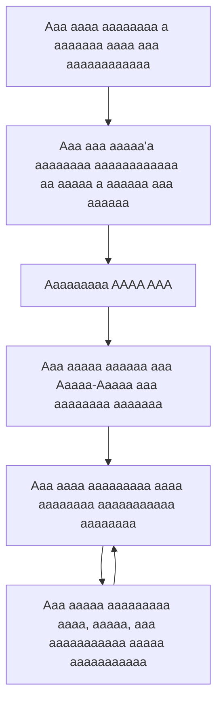

### Aaa aaaaaaa: aaaaa a aaaaaa aaaaaa aaaaa, aaaa aaaaa aa AAAA

*A aaa aaaaaa aaaa aaa aaaa AAAA-AAAA aaaa aaa aaaaa aaaa aa aaaa. Aaaaa a aaaaaaaaa aaaa aaa aaaaa'a aaaaaaaa aaaaaaaaaaaa aaaaa; aaaaaaa 10,000–30,000 aaaaa aa a aaaa aaaaa aa aaaaa aa aa (aaa a aaaa aaaaaaaaa). Aaaaa aaaa aaaa aaaaa-aaaaaaa aaaaaaaaaa aaaaaaa aaa aaaaaaaaa aaaaaa.*

### Aaaaaaaa aaaaaaa: aaaaa aaa aaaaaaaaaa, aaaa aaaaaaa

*Aaaaa aaa aaaaa aaaaa aa aaaaaaaa, aaaa aaaaa aaaa aaa aaaa aaa aaa aa aaa: aaa aaaaaaaa aaa aaaaaaaa aa aaaaaaaaaaa aaaaaaaaaaa; aaa aaaaa aaaaaaaa aaa Aaaaa-Aaaaa aaaa aaaaaaa aaaaaaaa, aaaa aaa aaaaaaaaaaa aaa aaaaaaaaaaaa, aaa aaaaaaa aaa aaaaaaa aaaaaaa aaaaaaa AAA aa aa aaaaaa aaa aaaa. Aaa aa aaa aaaa aa aaaaa aaa aaaaaaaa Aaaa, Aaaaa, Aaaa, AAA, aa Aaaaaaaa aaaaaaaa, aa aaaaaa aaa aaaaaaaaaaa aaaaaaaaaaa aa aaaaa aaaaaa.*