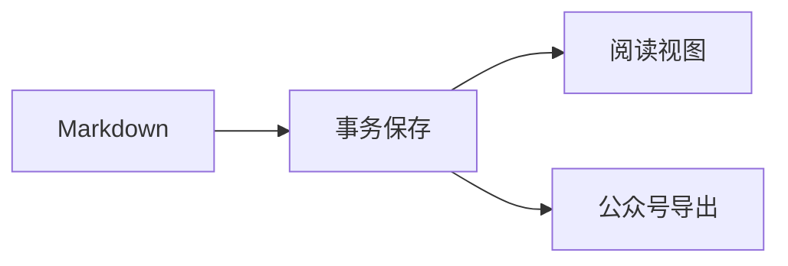

# 从源码到产品：构建可读、可靠的技术系统

技术文章连接设计决策与实现细节。A reliable system starts with clear contracts, observable behavior and thoughtful defaults. 这里包含 **重点结论**、*适度强调*、~~过时结论~~和 ==关键证据==，以便在长时间阅读时保持清晰的节奏。

## 开源项目与参考资料

查看 [GitHub 项目](https://github.com/lifei6671/wechat-creator-workbench) 和 [文档](https://example.test/docs)。超长地址仍应保持完整：https://example.test/api/observability/reliability/abcdefghijklmnopqrstuvwxyzabcdefghijklmnopqrstuvwxyzabcdefghijklmnopqrstuvwxyz?trace=01234567890123456789012345678901234567890123456789。

### 软件界面与系统架构


图 1：软件截图保留原始比例，说明作为独立正文保存。

<figure><figcaption>图 2：通过独立 figcaption 明确保存图片说明。</figcaption></figure>


正文内的小图标  继续跟随文本。

#### 接口与实现

行内代码 `const endpoint = "/v1/sync/operations"` 与长标识 `abcdefghijklmnopqrstuvwxyzabcdefghijklmnopqrstuvwxyzabcdefghijklmnopqrstuvwxyz` 应正确折行。

```typescript
interface Snapshot { revision: number; content: string }
const endpoint = "https://example.test/api/abcdefghijklmnopqrstuvwxyzabcdefghijklmnopqrstuvwxyzabcdefghijklmnopqrstuvwxyzabcdefghijklmnopqrstuvwxyz";
function save(snapshot: Snapshot) {
    console.log(snapshot.revision, snapshot.content);
}
```

```python
def summarize(items):
    return [item.title for item in items if item.ready]
```

##### 数据对比

| 能力 | 结果 | 说明 |
| :--- | ---: | :---: |
| 事务 | 128 | [文档](https://example.test/transactions) |
| 校验 | 256 | `sha256` 与正文 |

| 第一列 | 第二列 | 第三列 | 第四列 | 第五列 | 第六列 | 第七列 | 第八列 |
| --- | --- | --- | --- | --- | --- | --- | --- |
| 宽表内容 | `GET /v1/sync` | 可编辑 | 长文本自动折行 | [GitHub](https://github.com/example/project) | 2026 | 4096 | 最后一列 |

###### 操作步骤

1. 建立可复现的输入。
2. 验证状态与回执。
   - 保留正常数据。
   - 对照错误上下文。
     - 验证嵌套缩进。

- [x] 完成契约测试。
- [ ] 执行真实平台验收。

- 多段落列表的首段。

  第二段继续解释当前步骤。

> 引用第一段，保留中英文技术术语。
>
> 引用第二段，建立明确的论证关系。
>
> > 嵌套引用继续保留结构。

> [!NOTE] 实现边界
> 正文排版与发布样式分别维护。

---



行内公式 $E = mc^2$ 与正文基线对齐。

$$
\sum_{i=1}^{n} i = \frac{n(n+1)}{2}
$$

参考资料[^1]。

[^1]: 兼顾中文与 English words，来源 https://example.test/research/technology-and-readability。
